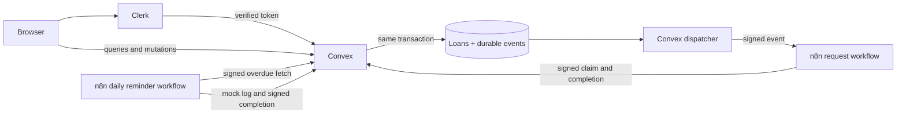

# LendLoop

**Borrow what you need. Lend what you don’t.**

A neighborhood tool-lending board built for the Fluence take-home assignment. Neighbors list tools, request inclusive date ranges, approve or decline requests, and confirm returns. Convex enforces authorization and reservation rules. n8n handles logged mock notifications and overdue reminders.

**Status:** local implementation, production build, and local automated tests are available. Clerk sign-in, a deployed Convex backend, and actual n8n workflow executions are **not yet verified**. The browser preview is fictional and does not authenticate users or deliver notifications. See [verification](docs/verification.md) before treating this as a completed submission.

## Quick local preview (no accounts)

Prerequisites: Node.js 22.21 or newer compatible LTS, npm, Git. Docker is only needed for n8n.

```sh
npm ci
npm run dev
```

Open `http://127.0.0.1:3000/preview`. This separate development route uses in-memory fictional data and resets on refresh. `/` shows the public design and an honest setup message until services are configured. `/workspace` is the real authenticated application. Production disables `/preview` unless `LENDLOOP_ENABLE_PREVIEW=true` is deliberately set **before building**. Do not use preview as evidence that integrations work.

```sh
npm run typecheck
npm test
npm run build
```

Tests use `convex-test`, a mock backend. Workflow contract tests execute the exported Code-node scripts with mock n8n bindings and actual Convex HTTP handler code. They do **not** run the n8n engine or validate Clerk JWTs.

## Stack and versions

Versions are pinned in `package.json` and `package-lock.json`:

| Component            | Version        | Responsibility                                        |
| -------------------- | -------------- | ----------------------------------------------------- |
| Next.js / App Router | 16.4.4         | Pages, responsive UI, auth proxy                      |
| React                | 19.3.1         | Client interactions                                   |
| TypeScript           | 7.0.2          | Static checking                                       |
| Clerk Next.js SDK    | 7.9.23         | Sign-in and signed identity tokens                    |
| Convex               | 1.49.0         | Data, authorization, transactional lending, outbox    |
| n8n Docker image     | 2.45.7         | Webhooks, scheduled reminders, mock notification logs |
| Vitest / convex-test | 5.1.0 / 0.0.66 | Local tests                                           |

Neon/PostgreSQL is not used: Convex is required by the assignment. AWS is not required for this exercise and is not claimed as implemented experience.

## Architecture



- `app/`, `components/`: public page, live workspace, separate preview, forms, accessible native dialogs, errors and empty states.
- `convex/`: schema, queries, mutations, actions, HTTP routes, cron recovery, internal administration and seed.
- `lib/`: UTC calendar rules and Web Crypto HMAC implementation.
- `n8n/workflows/`: three importable exports; no credentials.
- `scripts/build-workflows.mjs`: readable source for the exported workflows.
- `tests/`: authorization, lending, transport, outbox, and workflow contract tests.
- `docs/`: production gaps, verification, demonstration and interview preparation.

## Connect Clerk and Convex

Use **new development projects** and fictional profiles. Do not reuse production secrets or customer data.

1. Create a Clerk application named `LendLoop` at <https://dashboard.clerk.com/>. Enable email sign-in. In the Clerk dashboard, activate the **Convex integration**. Record the Frontend API URL (development format: `https://your-instance.clerk.accounts.dev`). This must match the JWT issuer and the Convex integration uses audience `convex`.
2. Copy `.env.example` to `.env.local`. On PowerShell: `Copy-Item .env.example .env.local`. Fill `NEXT_PUBLIC_CLERK_PUBLISHABLE_KEY` and `CLERK_SECRET_KEY` from the Clerk API keys page. Keep `.env.local` ignored.
3. Run `npx convex dev`. Sign in interactively, create/select a new `LendLoop` development project, and allow the CLI to write `CONVEX_DEPLOYMENT` and `NEXT_PUBLIC_CONVEX_URL` into `.env.local`. The first synchronization may complain about the missing issuer; configure it in the next step, then restart the command.
4. In the Convex development deployment dashboard, open **Settings → Environment Variables** and set `CLERK_JWT_ISSUER_DOMAIN` to the URL from step 1. No trailing slash. This value belongs to the Convex runtime, not just the Next.js env file.
5. Restart `npx convex dev`. Confirm schema and functions deploy successfully. The CLI regenerates `convex/_generated` using your deployment. Initial checked-in bindings were bootstrapped offline from the installed SDK; they are not proof of a deployment.
6. In a second terminal run `npm run dev`. Open `/`, choose **Sign in to lend or borrow**, and finish the display-name form. A nickname is fine. The backend creates a `user` profile regardless of any browser-supplied role.
7. Create a second test Clerk account in another browser profile/private window. Complete its profile. Use these two accounts for the live checklist.

If sign-in works but Convex remains unauthenticated, check issuer URL, audience `convex`, that the integration is enabled, and that Next.js and the CLI point to the **same development deployment**. Never solve this by removing backend identity checks.

### First administrator

There is no public role-changing mutation and no automatic first-user promotion. After the account has a profile, an operator with Convex deployment access can use the dashboard function runner to invoke the **internal** `profiles:setRole` function:

```json
{ "subject": "user_COPY_THE_TEST_USER_ID_FROM_CLERK", "role": "admin" }
```

Equivalent CLI command (after checking which development deployment is selected):

```sh
npx convex run profiles:setRole '{"subject":"user_REPLACE_ME","role":"admin"}'
```

Use the same function with `role: "user"` to revoke. This is administrative deployment access, never a browser API. Role changes produce an audit record marked `operator.role.*`; the deployment operator identity must be reviewed in platform logs because it is not a user session. Protect Convex dashboard access with MFA. Admins see all loans, remove any listing, mark lenders as trusted, and retry terminal notification failures. They do not gain permission to approve or return other people's loans.

## Start n8n

1. Install Docker Desktop, launch it, and verify `docker compose version`. Docker was not present on the initial development PC.
2. Copy `n8n/.env.example` to `n8n/.env`. Generate **three separate random secrets**, one each for `N8N_ENCRYPTION_KEY`, `AUTOMATION_OUTBOUND_SECRET`, and `AUTOMATION_INBOUND_SECRET`. Example generator:

   ```sh
   node -e "console.log(require('node:crypto').randomBytes(32).toString('hex'))"
   ```

   Run it separately for each secret, paste privately into the local env file, and do not send them in chat or commit them.

3. Set `CONVEX_SITE_URL` to the development deployment's **HTTP Actions URL**, ending in `.convex.site`, not `.convex.cloud`. Copy from the Convex dashboard.
4. Set the same two automation secrets in the **Convex** environment variables. Outbound means Convex → n8n; inbound means n8n → Convex. The encryption key stays only in n8n.
5. Run `docker compose up -d`. Open `http://localhost:5678` and create the local owner account. This Compose binds to loopback, uses persistent named storage and internal task runners for an isolated, single-owner, fictional-data environment. See [production](docs/production.md) before changing its exposure.
6. Import `n8n/workflows/error-handler.json` first using n8n **Import from file**. Save it. Import `request-notification.json` and `overdue-reminders.json`. In **Settings** for each of those two workflows, select **LendLoop — C · Sanitized error log** as the Error Workflow, then save. IDs differ per installation, so the export does not hard-code the error workflow ID.
7. Confirm Code nodes can access `crypto` and the two automation environment variables. The supplied Compose sets `NODE_FUNCTION_ALLOW_BUILTIN=crypto` and permits environment access for these trusted workflows. Do not grant untrusted users workflow-editor access to this local instance.
8. Publish/activate workflows A and B. A uses the permanent path `/webhook/lendloop-events`. The HMAC binds this exact path; `/webhook-test/` deliberately does not work with this export.
9. Set `N8N_WEBHOOK_URL` in Convex to the **reachable** permanent webhook URL. A cloud Convex deployment cannot reach your PC's `localhost`. Choose an isolated n8n development service on your dedicated host over HTTPS, or arrange an explicitly authorized development tunnel. Do not assume `WEBHOOK_URL` exposes a local service; it only tells n8n its external URL. No tunnel or public deployment has been created by this repository.
10. Create a request and inspect n8n Executions and the Convex `events` / `notificationResults` tables. Only an authenticated completion callback sets `simulated`. An HTTP 200 from the webhook alone is not success.

Workflow B runs in the **09:00–23:45 UTC daily window**, every 15 minutes, to recover failed attempts. A durable key `loanId:reminder:YYYY-MM-DD` limits the logical reminder to once per UTC day. Manually executing B is allowed in a development deployment. A maximum of 100 overdue loans is scanned per execution; increase this with pagination before scaling beyond the exercise.

Regenerate exports after changing workflow source with `npm run workflows`, and reimport reviewed changes. The n8n editor and runner must still be tested: contract tests do not validate node versions or engine configuration.

## Authorization and business rules

| Operation                      | Permitted actor                                              |
| ------------------------------ | ------------------------------------------------------------ |
| Public availability            | Anyone; response has only `name`, `category`                 |
| Browse detailed listings       | Authenticated, registered user                               |
| Create listing                 | Registered user; owner derived from identity                 |
| Edit listing                   | Owner, active listing, no pending/approved loans             |
| Remove listing                 | Owner without approved loans; admin may moderate any listing |
| Request loan                   | Registered non-owner                                         |
| Approve / decline              | Owner only, from pending                                     |
| Cancel                         | Borrower only, from pending                                  |
| Confirm returned               | Owner only, from approved                                    |
| Read loan + activity           | Its participants or admin                                    |
| Change trust / retry failure   | Admin only                                                   |
| Change role / development seed | Deployment operator via internal functions only              |

Removal soft-deletes the listing and declines pending requests, creating notification events. An admin may remove a listing with approved loans; those loans remain returnable and auditable. No business history is hard-deleted through the UI. The current caps are 30 active listings per owner and 20 active requests per borrower.

Dates are UTC calendar strings `YYYY-MM-DD`. Both endpoints are inclusive. Same-day loans are valid; the start cannot be in the past, bookings must start within one year, and a loan may cover at most 31 calendar days. Approval revalidates dates. Pending requests are not reservations. Approved overlapping loans are prohibited. Overdue approved loans block all further bookings until the owner confirms return. Public availability means “not currently checked out”; future reservations are shown only in the authenticated view. Time-driven Convex queries refresh on the next query/invalidation; they are not a precise midnight timer.

Approval reads the indexed reservations and increments the shared tool revision in the **same Convex transaction**. Convex retries conflicting transactions under optimistic concurrency control; the retried transaction sees the winner's reservation. Unit tests cover logical overlap, but a real simultaneous-approval check remains on the live verification list.

## Signing, replay control and reliability

Each POST contains an envelope `{timestamp, nonce, payload, signature}`. `payload` is a JSON **string** so both sides sign the same UTF-8 bytes, regardless of envelope serialization. The canonical signed string is:

```text
v1\nPOST\n<exact pathname>\n<timestamp in milliseconds>\n<nonce>\n<exact payload string>
```

HMAC-SHA256 uses independent inbound and outbound secrets. The receiver rejects envelopes more than five minutes old or ahead of its clock, malformed nonces and invalid signatures. Convex uses Web Crypto verification; n8n uses Node `timingSafeEqual` on fixed-length digests. HTTPS is required when hosted. HMAC provides authenticity and integrity, not encryption.

Convex's signed HTTP routes allow only overdue selection, event claim, and a `simulated` completion. They cannot change loans or roles. Nonce receipts and effects are committed together. An identical valid transport retry returns the stored response without new effects; reuse of a nonce with a different signature is rejected. Receipts expire after ten minutes; by then the envelope is too old to validate. An event/attempt claim also suppresses a replay of the original Convex webhook across separate n8n executions.

Loan mutations and outbox inserts are atomic. A Convex cron dispatches up to ten due request events per minute. Attempts hold a two-minute lease; timeouts are 15 seconds; retry delay after a transport error is `30 seconds × 2^attempts`, up to five attempts. Accepted webhooks without a completion callback are retried after the lease. Completion is idempotent by event ID. Failure state and attempt count remain visible; admin can reset terminal failures for another bounded retry cycle. Old reminder windows expire visibly and cannot be manually resent as if they were today's reminder.

This is **at-least-once execution with idempotent logical results**, not exactly-once delivery. A workflow can log a mock notification and crash before the completion callback; a later attempt may log it again. A real provider would need its own idempotency key/status lookup. Workflow error records and durable event status provide observability; production alerting is a documented gap.

## Seed and demonstrate

Sign in with two fictional test accounts and create their profiles first. In the **development** Convex environment set `ENABLE_DEMO_SEED=true`, then run internal `seed:demo` through the dashboard with:

```json
{
  "ownerSubject": "user_OWNER_TEST_ID",
  "borrowerSubject": "user_BORROWER_TEST_ID"
}
```

The owner must have no listings. The seed creates a drill with an overdue approved loan and an available tent. It bypasses normal date validation intentionally and is not a public function. Unset `ENABLE_DEMO_SEED` after seeding. Never enable it in production. See [demonstration](docs/demo.md).

## Privacy, limitations and production

Only Clerk stores credentials and login contact details. Business profiles store a Clerk subject, chosen display name, role and trust flag. Public queries use an explicit allow-list. Automation payloads contain event/attempt IDs, a status, kind and an opaque recipient reference; no email, address, description, or Clerk subject. Log messages exclude secrets and tokens. This exercise uses only fictional data and does not claim HIPAA, GDPR or LGPD compliance.

There is no payment system, messaging, address exchange, real email delivery or account erasure UI. Listing and loan views are capped at 200; no production pagination exists. n8n successful execution storage is disabled, failed executions are retained for 72 hours, and receipt cleanup runs every ten minutes. Business/audit records are retained for the development exercise; production retention and erasure policy are not implemented. Font loading currently uses Google Fonts with system fallbacks; review external requests or self-host fonts for production. Details: [production readiness](docs/production.md).

## Deployment later

Keep the repository private during review. Nothing here publishes automatically. For Vercel, import the repository only after authorization, configure the Next.js variables for the appropriate Clerk/Convex environment, deploy the backend with `npx convex deploy`, and rebuild the frontend with that deployment URL. Use a separately secured n8n host; Vercel does not run this Compose service. Do not reuse development credentials for production. A dedicated server may run the Next.js app and n8n as separate services, but keep Convex as the required backend. Review the full [live checklist](docs/verification.md) before submission.

## AI assistance and ownership

The implementation, tests, design and documentation were developed with an AI coding assistant. Lucas supplied the target assignment, local-first scope and hosting preferences. Architecture and security-policy choices in this iteration were proposed by the assistant; Lucas still needs to review them, run the live demonstration and practice the exercises. No claim is made that unrun integrations have been verified or that Lucas already has production AWS/Clerk/Convex experience. See [interview preparation in Portuguese](docs/interview-guide-pt.md).

## Official references consulted

- [Assignment](https://remotive.com/remote-jobs/software-development/full-stack-developer-2091165), checked November 2, 2026. The supplied brief matches the required stack and main flows; its additional reliability/privacy requirements go beyond the short advertisement. AWS production experience is listed for the job, not as a required assignment deployment.
- Next.js installed version docs: `node_modules/next/dist/docs/01-app/01-getting-started/03-layouts-and-pages.md`, `05-server-and-client-components.md`, `16-proxy.md`, and `01-app/02-guides/environment-variables.md`.
- [Clerk Next.js quickstart](https://clerk.com/docs/nextjs/getting-started/quickstart), [Convex + Clerk](https://docs.convex.dev/auth/clerk), [Convex OCC and atomicity](https://docs.convex.dev/database/advanced/occ), [convex-test](https://docs.convex.dev/testing/convex-test).
- [n8n Docker](https://docs.n8n.io/hosting/installation/docker/), [Code node](https://docs.n8n.io/integrations/builtin/core-nodes/n8n-nodes-base.code/), [HTTP Request](https://docs.n8n.io/integrations/builtin/core-nodes/n8n-nodes-base.httprequest/), [Webhook](https://docs.n8n.io/integrations/builtin/core-nodes/n8n-nodes-base.webhook/), [task runners](https://docs.n8n.io/hosting/configuration/task-runners/), [security variables](https://docs.n8n.io/hosting/configuration/environment-variables/security/).
